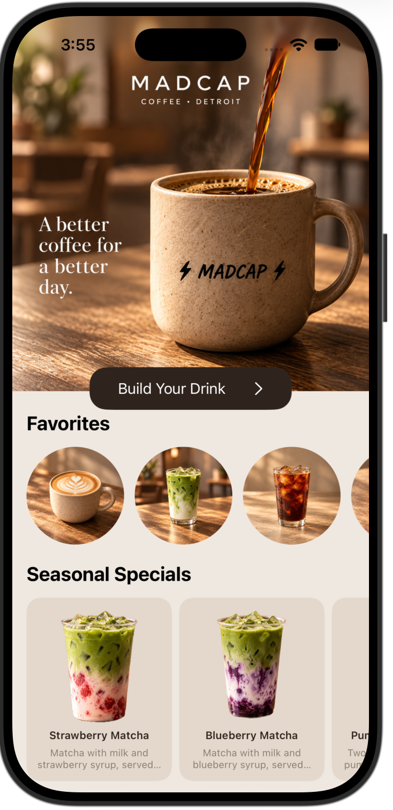
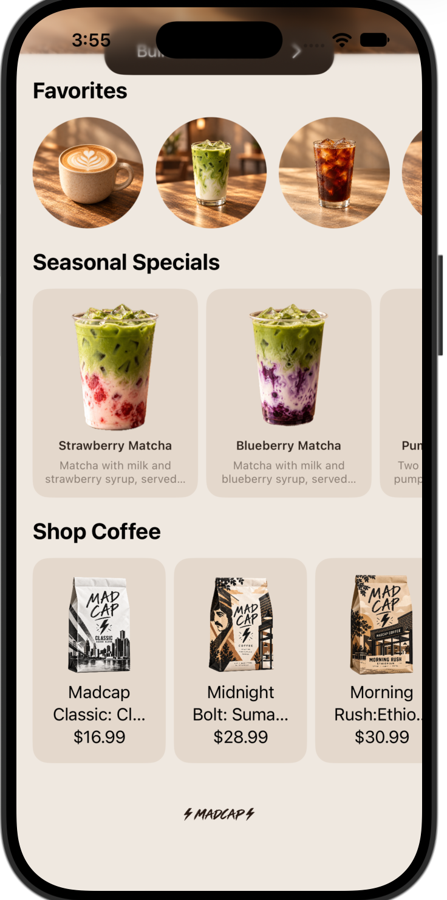
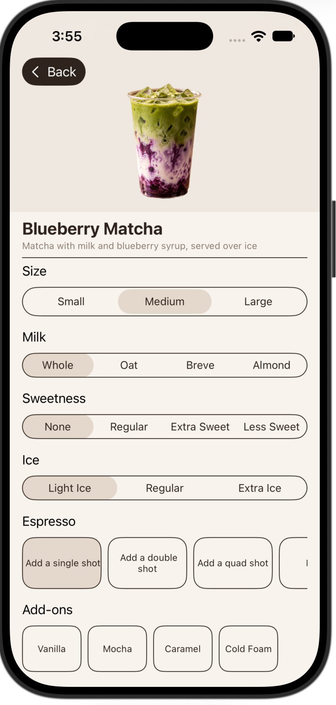
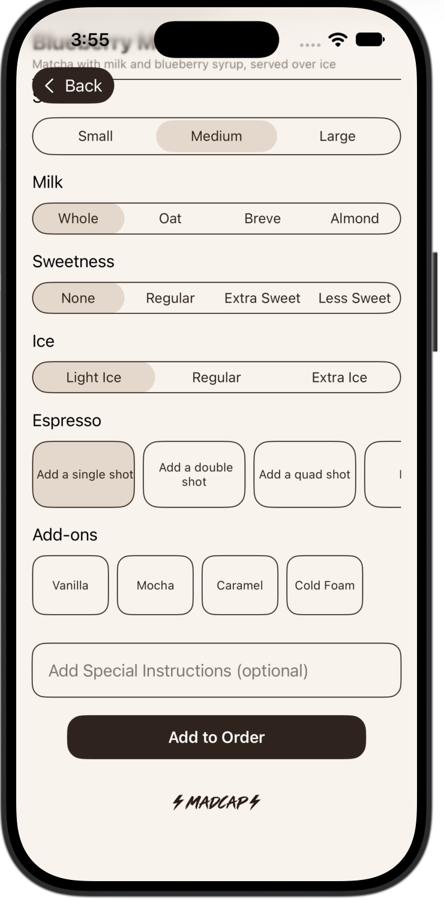
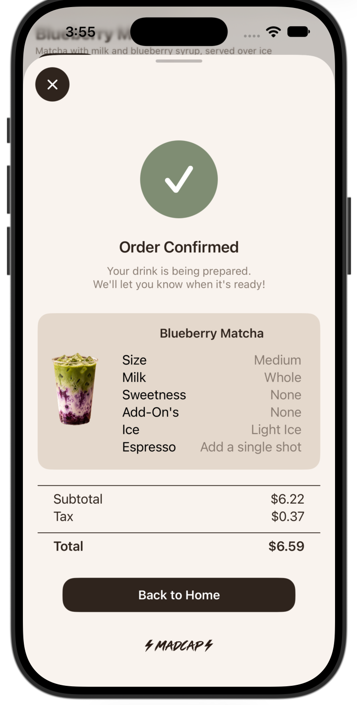

# MadCap Coffee App ☕

An interactive iOS coffee ordering application developed using **Swift, SwiftUI, and Xcode** as part of an assignment at the **Apple Developer Academy**.

## About the Project

I designed and developed the MadCap Coffee App as part of a hands-on assignment at the Apple Developer Academy. The goal was to create an engaging, user-friendly mobile application inspired by the Madcap Coffee brand.

The app features multiple interconnected screens that allow users to navigate through a coffee ordering experience, from exploring the menu to customizing beverages and reviewing their order.

My focus was on developing a cohesive user experience through functional navigation, interactive features, and a clean, visually appealing interface.

## Key Features

- **Interactive Navigation:** Connected screens allow users to navigate between different sections of the app.
- **Menu Exploration:** Browse featured coffee drinks, seasonal specials, and available products.
- **Drink Customization:** Personalize beverages by selecting size, milk type, sweetness, ice level, espresso shots, and additional flavors.
- **Order Review:** View selected items and pricing on a dedicated order confirmation screen.
- **User-Centered Design:** Consistent visual elements and intuitive navigation help create a seamless experience.

## App Screenshots

### Home Screen

### Menu and Product Browsing

### Drink Customization

### Additional Customization and Ordering

### Order Confirmation

## Technologies Used

- **Swift** — Application development
- **SwiftUI** — User interface design and implementation
- **Xcode** — Development environment
- **iOS Simulator** — Application testing and previewing

## Skills Developed

Through this project, I gained hands-on experience in:

- iOS application development
- UI/UX design and user-centered thinking
- Building interactive interfaces and navigation flows
- Translating design concepts into a functional prototype
- Troubleshooting and refining application features
- Product development and user experience optimization

## Project Background

Developed as an educational assignment at the Apple Developer Academy. This is an independent app concept inspired by Madcap Coffee and is not an official application affiliated with the company.
